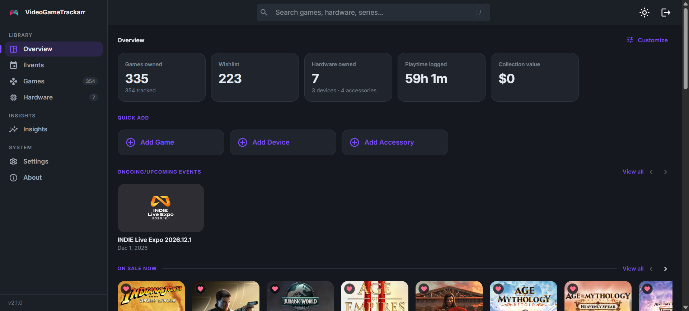
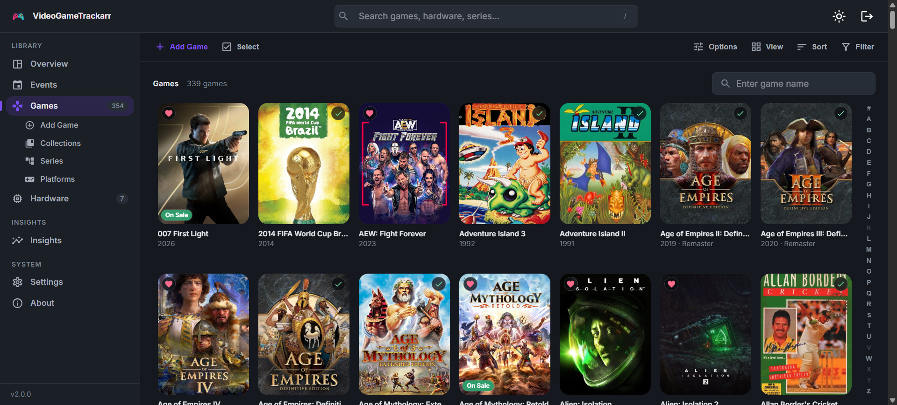
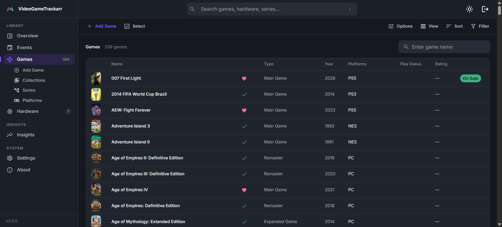
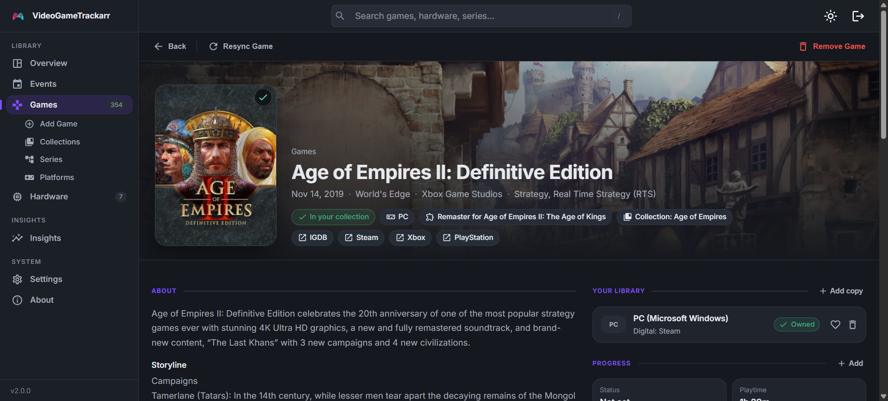
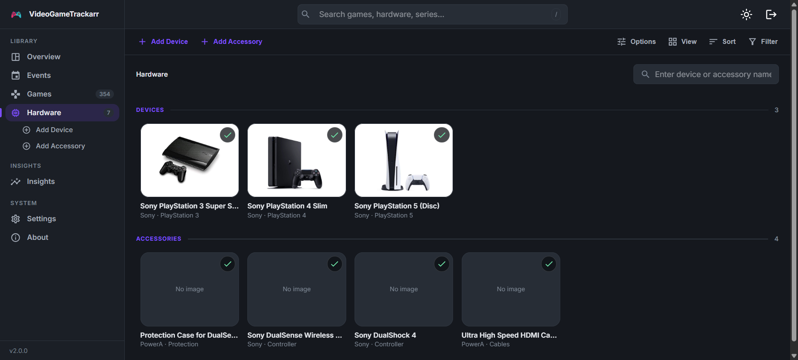
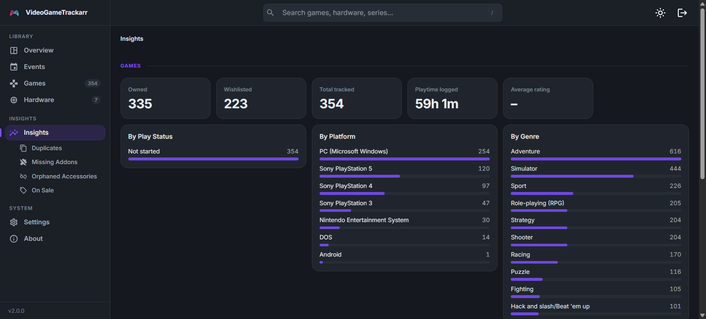
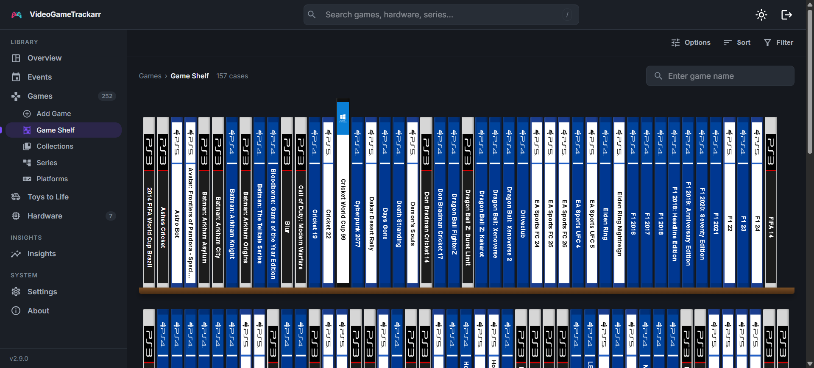

<p align="center">
  
</p>

<h1 align="center">VideoGameTrackarr</h1>

<p align="center">
  A self-hosted web app for tracking your video game collection — what you own, what you want,
  what you're playing, and how it's going — with Steam sync, wishlist sale alerts, and in-browser
  play for the games you own.
</p>

<p align="center">
  <a href="https://github.com/wwwescape/VideoGameTrackarr/releases"></a>
  <a href="https://github.com/wwwescape/VideoGameTrackarr/commits/master"></a>
  <a href="https://github.com/wwwescape/VideoGameTrackarr"></a>
</p>

## Screenshots









## Features

- **Library tracking** — owned games and a wishlist, per platform, region, and format
  (physical, digital, ISO, ROM, or Abandonware), with edition, storefront, steelbook, notes,
  and purchase or target price.
- **IGDB-powered catalog** — search IGDB, preview a game before adding it, or bulk-add several
  at once. Genres, companies, platforms, media, release dates, store links, collections, series,
  and addons (DLC, expansions, and packs) all come along.
- **Personal tracking** — progress, play sessions and a review per platform you own a game on,
  your own 1–10 star rating per game (shown beside IGDB's member and critic ratings), notes, and
  colored tags (with a Tag Manager and bulk tagging).
- **Views, filters & sort** — Covers, Table, or Overview views with an adjustable card size;
  filter by platform, format, storefront, tag, ownership, play status, game type, source,
  steelbook, collection, or series (each with an Exclude option), or, with the Screensaver lab
  on, whether a game is shown in the screensaver; sort by name or release date. Pages remember
  your search, filters, and sort.
- **Game Shelf** (Labs) — your physical games as cases on a shelf, one per platform you own
  each on, drawn at their real relative sizes in each platform's spine colours and logo, with
  the usual search, filters, and sort, plus a scale slider. Cases come from a curated list of
  standard retail cases (cartridge-only systems have none); turn a platform's cases on or
  off in **Settings → Game Cases**, where each preview opens large.
- **Screensaver** (Labs) — a floating button that shows your game covers full screen, one
  after another, with the VideoGameTrackarr badge in the corner; swipe to browse, tap a cover
  to open the game. Set the time per cover in **Settings → Screensaver**, and hide a game from
  its page, or many at once from the Games list. Handy on a wall-mounted tablet.
- **Labs** — opt-in features that are still taking shape, off by default and switched on in
  **Settings → Labs**.
- **Hardware** — devices and accessories from a curated Sony, Microsoft, Nintendo, and Sega
  catalog, with product photos.
- **What's New** — after an upgrade, the release notes of every version you haven't seen
  yet, shown once per account.
- **Toys to Life** — every LEGO Dimensions pack, starter kits included, each with its own page
  for your copies (owned or wishlisted, with a price and notes), your rating, tags, and notes;
  the game's page lists them in place of its add-ons.
- **Steam sync** — import your Steam library and wishlist with playtime, review every change
  before it's applied, and relink or unlink mismatched entries.
- **Sale tracking** — opt-in wishlist price tracking via IsThereAnyDeal (PC, Mac, Linux, and
  Android) and PlatPrices (PlayStation), with target prices and an **On Sale** page.
- **Events** — upcoming gaming-industry events from IGDB, with any featured games already in
  your library.
- **In-browser play** — upload ROMs for games you own and play over 25 systems right in the
  browser, with a self-hosted emulator and saves kept on your server. See
  [docs/emulation.md](docs/emulation.md).
- **Media viewer** — a lightbox for screenshots and artwork, and a video player for trailers.
- **Overview & insights** — headline numbers, what you're playing, recent additions, and gaps
  worth filling on the Overview; breakdowns by play status, platform, genre, and hardware on
  Insights; plus release calendars, duplicate detection, missing addons, orphaned accessories,
  and side-by-side game comparison.
- **Share links** — unlisted, read-only links to your Games, Game Shelf, or Hardware
  collection.
- **Jobs** — scheduled catalog resyncs, Steam import, sale refreshes, and event syncs, with live
  progress, a log of each run, and catch-up of runs missed while the app was down.
- **Backup & restore** — one JSON backup of your library, hardware, target prices and settings,
  or a `.zip` that also carries your pick of ROMs and saves, BIOS files and uploaded images,
  with an automatic safety snapshot before every restore.
- **PWA** — installable (see [Installing the app](#installing-the-app)), works offline for
  anything you've already viewed, and syncs offline edits when you reconnect.
- **Design** — light, dark, and high-contrast modes with your choice of accent color (Material 3
  color schemes), a sidebar that becomes a drawer on phones, and virtualized lists for large
  collections.
- **Languages** — English, Spanish, French, and Portuguese.
- **Single admin, self-hosted** — no public registration, no multi-tenancy.

## Installation

The published Docker image bundles the frontend and backend into a single container. Create a
`docker-compose.yml`:

```yaml
services:
  app:
    image: wwwescape/videogametrackarr:latest
    container_name: videogametrackarr
    ports:
      - "8000:8000"
    env_file:
      - .env
    volumes:
      - db-data:/app/backend/db
      - uploads-data:/app/backend/uploads
    restart: unless-stopped

volumes:
  db-data:
  uploads-data:
```

Create a `.env` file next to it (see [Configuration](#configuration)), then start it:

```bash
docker compose up -d
```

Open `http://localhost:8000`. The first visit shows a create-admin form — fill it in once and
you're signed in. It asks for a one-time setup code, so nobody else who reaches the page first
can claim your instance: find it with `docker compose logs app` (or set your own with
`SETUP_CODE` in `.env`). Change your password later under **Settings → General → Account**. If
you ever get locked out,
`docker compose exec app python -m scripts.create_admin --username admin` resets the password.

Migrations run automatically on startup, and your database and uploads live in the named
volumes, so they survive restarts and upgrades. Reverse proxy examples (Nginx, Traefik) are in
[docs/deployment/](docs/deployment/).

### Upgrading

```bash
docker compose pull && docker compose up -d
```

Running from source instead? `git pull`, reinstall dependencies if they changed, then run
`alembic upgrade head` from `backend/` before starting the app. Any breaking change is called
out in that release's notes.

### Installing the app

VideoGameTrackarr can be installed like an app, with its own window and home-screen or desktop icon.
**Settings → General → App** has an **Install** button where the browser offers one (Chrome, Edge, Android),
and says how otherwise (on an iPhone or iPad: Share → Add to Home Screen). Browsers only install
apps opened over **HTTPS** (or on `localhost`): at a plain `http://` address such as
`http://192.168.1.10:8000`, use a reverse proxy with a certificate or a Cloudflare tunnel.

## Configuration

Settings live in `.env` (see [.env.example](.env.example) for every option). Only IGDB and a JWT
secret are required:

```env
IGDB_CLIENT_ID=your_igdb_client_id
IGDB_CLIENT_SECRET=your_igdb_client_secret
JWT_SECRET_KEY=            # generate with: python -c "import secrets; print(secrets.token_hex(32))"
```

Get IGDB credentials at https://api-docs.igdb.com/#getting-started (free, requires a Twitch
developer account).

Optional integrations — add a key to `.env`, then run `docker compose up -d` (a plain
`docker compose restart` doesn't pick up `.env` changes). Each shows a live status in
**Settings → Integrations**, along with the store region in use for the price integrations:

| Integration    | Setting              | Get a key                                                         | Notes                                                                                                                                      |
| -------------- | -------------------- | ----------------------------------------------------------------- | ------------------------------------------------------------------------------------------------------------------------------------------ |
| Steam          | `STEAM_API_KEY`      | [steamcommunity.com/dev/apikey](https://steamcommunity.com/dev/apikey) | Your SteamID64 is set in-app, under **Settings → Integrations**.                                                                     |
| IsThereAnyDeal | `ITAD_API_KEY`       | [isthereanydeal.com/apps/my](https://isthereanydeal.com/apps/my/) | PC, Mac, Linux, and Android prices. `ITAD_COUNTRY` (two-letter code, default `US`) sets the store country.                                |
| PlatPrices     | `PLATPRICES_API_KEY` | [platprices.com/api-request](https://platprices.com/api-request) | PlayStation prices. The free tier tracks any 2 PS Store regions, chosen on your PlatPrices dashboard. `PLATPRICES_REGION` (two-letter code such as `GB` or `IN`, default `US`) must be one of them. |

Other options: `ROM_MAX_UPLOAD_MB` (default `2048`) caps ROM uploads — raise your reverse
proxy's upload limit to match. Behind a reverse proxy, set `FORWARDED_ALLOW_IPS` to the proxy's
address (or its Docker network, such as `172.16.0.0/12`) so login rate limits count each visitor
rather than the proxy. Set `TZ` (such as `Europe/Lisbon`) so job schedules run in your
timezone; Docker containers otherwise use UTC. `DATABASE_URL` (SQLite by default), `REDIS_URL`, and
`CORS_ORIGINS` are optional.

## Development

Requires [Git](https://git-scm.com/downloads), [Node.js 22+](https://nodejs.org/en/download/current),
and [Python 3.12+](https://www.python.org/downloads/).

```bash
git clone https://github.com/wwwescape/VideoGameTrackarr.git
cd VideoGameTrackarr
npm install
cd backend
python -m venv .venv
.venv\Scripts\activate          # Windows; use `source .venv/bin/activate` on macOS/Linux
pip install -r requirements-dev.txt
alembic upgrade head
```

Create `.env` in the project root as described in [Configuration](#configuration), then run the
backend and frontend in two terminals:

```bash
cd backend && .venv\Scripts\activate && uvicorn app.main:app --reload --port 8000
```

```bash
npm start
```

The frontend runs on `http://localhost:3000` and talks to the backend on `http://localhost:8000`.

### Test

```bash
npm run lint && npm run typecheck && npm test && npm run build
cd backend && ruff check . && pytest
```

A Playwright end-to-end suite (`npm run test:e2e`) covers critical user journeys as a manual
pre-release check — see [e2e/README.md](e2e/README.md).

### Release a new version

```bash
git tag v1.26.0
git push origin v1.26.0
```

The tag push publishes the Docker image to GHCR and Docker Hub (tagged with the version and
`latest`) and creates a GitHub Release. Publishing to Docker Hub needs the `DOCKERHUB_USERNAME`
and `DOCKERHUB_TOKEN` repository secrets.

### Project layout

```
frontend/   TypeScript, Vite, MUI, TanStack Query, React Router — own package.json
backend/    FastAPI, SQLAlchemy, Alembic (SQLite by default) — own requirements.txt
e2e/        Playwright end-to-end suite (manual pre-release check)
docs/       Developer guide, diagrams, emulation guide, and deployment examples
```

See [docs/developer-guide.md](docs/developer-guide.md) for conventions, and
[CONTRIBUTING.md](CONTRIBUTING.md) if you're sending a PR.

## License

GPL-3.0 — see [LICENSE](LICENSE).

## Support

If you find VideoGameTrackarr useful, consider buying me a coffee:

[](https://buymeacoffee.com/wwwescape)
